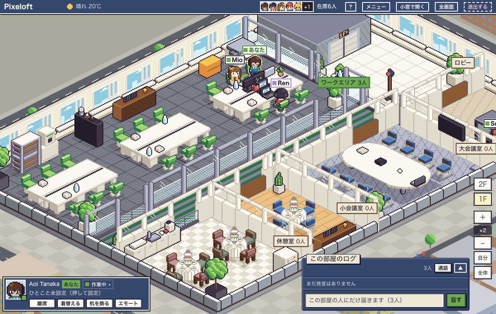

# Pixeloft

[English](README.md)

席に座るタイプの、アイソメ調ドット絵のバーチャルオフィスです。自分も同僚もそれぞれの席に座っていて、誰がいるかがひと目でわかります。`docker compose up`を1回実行すると、アプリとPostgreSQLが起動します。間取りはGUIのエディタで作れます。

- [ブラウザでマップを作る](https://yhrym.github.io/pixeloft/editor/)：登録は要りません。サンプルのオフィスを開いて、そのまま編集できます
- [自分のPCで起動する](#クイックスタート)：Docker Composeの手順です




（スクリーンショットは同梱のサンプルマップで、間取りはすべて架空のものです）

## 特徴

- 席を選ぶとキャラクターが着席します。歩かせる操作はいりません。席を選ぶと、キャラクターが自分でそこまで歩きます。オフィスのタブを15分間操作しないと、自動で離席になります。
- 状態はポーリングで更新します。画面の表示中は4秒ごとに取得し、非表示中は60秒ごとにハートビートを送ります。WebSocket接続のためのプロキシ設定は不要です。HTTPSで公開する場合の設定は、下の「リバースプロキシでHTTPSにする」を参照してください。
- 在席表示では、いる部屋と状態（作業中・集中・休憩・会議中）がわかります。席にいる時間や、最後に操作した時刻は表示しません。

## 機能

- 入室・退出・離席の状態を表示します。オフィスのタブを15分間操作しないと自動で離席中になり、日付が変わるとリセットされます。設定した終業時刻を過ぎて操作がない場合は、自動で退出します
- 状態は作業中・集中（25分）・休憩・会議中です。部屋の種類で自動で付くものもあります
- チャットは部屋ごとで、今いる部屋の分がその日のあいだ表示されます。1件200字まで送れて、メンション、リアクション、60秒以内の取り消しに対応しています
- 「ちょっといい？」の声かけと手振りは、オフィスの画面に表示されます。「ちょっといい？」は、通知を有効にしてブラウザでも許可すると、タブを閉じていてもWeb Pushで受け取れます。HTTPSかlocalhostが必要です。設定方法は「リバースプロキシでHTTPSにする」を参照してください
- 部屋ごとに通話URL（Meet・Zoom・Teamsなど何でも）を設定できます
- 着せ替え：髪・服・ズボンの色は自由に選べます。髪型・服・小物はドット絵で描いて追加でき、描いたパーツは全員が使えます
- マップエディタでは、真上から見た2Dの図面で編集し、斜め見下ろしのプレビューで確認できます。アプリの中（`/editor`、管理者のみ）と、GitHub Pagesの静的ページの両方で使えます
- 時間帯に合わせて光が変わり、天気（Open-Meteo。任意）や季節の飾りも表示できます
- 招待リンクとパスワード再設定リンクでメンバーを管理します。メールや外部のログインサービスは使いません
- 日本語と英語を切り替えられます

## クイックスタート

Git、Docker（Compose付き）、ブラウザを用意してください。

```sh
git clone https://github.com/yhrym/pixeloft.git
cd pixeloft
docker compose up -d
```

自分のPCで起動した場合は、<http://localhost:3000/setup>を開きます。サーバーで起動した場合は、そのサーバーのURLに`/setup`を付けて開いてください。

## 初回の/setup

ユーザーが1人もいないとき、`/setup`で最初の管理者（ログインID・表示名・パスワード）と最初のマップを決めます。

- **サンプルを使う**（既定）：架空の2フロアのオフィスです。言語はブラウザの設定に合わせます
- **JSONを読み込む**：エディタで書き出したマップを使います
- **空のオフィスで始める**：`/editor`で間取りを作ります

初期設定が終わったあとに`/setup`を開くと、ログイン画面に移ります。作成した管理者でログインし、「入室する」を押します。空いている席を選ぶか「おまかせで座る」を押すと入室できます。「空のオフィスで始める」を選んだ場合は、ログイン後にメニューの「エディタ」を開き、部屋・入口・机を置いて「公開」を押してから、オフィスに戻って入室します。そのあと、メニューの「メンバー管理」で招待リンクを作って渡します。

## 設定

環境変数はすべて任意です。

| 変数 | 既定 | 内容 |
|---|---|---|
| `APP_URL` | 空 | 公開URL（例：`https://office.example.com`）。招待・再設定リンクとWeb Pushの連絡先に使います |
| `TZ` | `Asia/Tokyo` | 最初のタイムゾーン（IANA名）。日付の切り替え・自動退出・光がこれに従います |
| `PORT` | `3000` | アプリにつなぐホスト側のポート |
| `TRUSTED_PROXY` | 空 | 自分で管理するリバースプロキシの後ろで動かすときに`1`にします。下の節を参照 |

`docker-compose.yml`と同じ場所の`.env`か、シェルの環境変数で渡します。これ以外の項目は、管理画面の設定ページ（`/admin/settings`）で変えます。対象は、タイムゾーン、終業時刻、天気の緯度経度、季節の飾り、部屋ごとの通話URLです。

## リバースプロキシでHTTPSにする

Web Pushとサービスワーカーは、HTTPS（か`localhost`）でしか動きません。アプリの前にリバースプロキシを置いてください。次は、証明書を自動で取得するCaddyの最小の例です。

```
office.example.com {
	reverse_proxy localhost:3000
}
```

先に、アプリのポートへ外部から直接アクセスできないようにしてください。`127.0.0.1`にだけ公開するか、ファイアウォールで制限します。そのうえで`.env`に次を書き、`docker compose up -d`をやり直します。

```
APP_URL=https://office.example.com
TRUSTED_PROXY=1
```

`TRUSTED_PROXY`が必要な理由は次のとおりです。同じキーでのログイン失敗が15分間に10回に達すると、その15分の枠が終わるまでログインを受け付けません。キーは`TRUSTED_PROXY`の有無で変わります。`TRUSTED_PROXY`がないと、アプリはアクセス元を区別できないので、失敗の回数をログインIDだけで数えます。IDを知っている人が間違ったパスワードを入力し続けると、その15分の枠が終わるまで、そのIDでログインできなくなります。`TRUSTED_PROXY=1`にすると、`X-Forwarded-For`（プロキシが追加した最後の値）からアクセス元を取り、IDとアクセス元の組で数えます。書き込みのOrigin確認も、`X-Forwarded-Host`と`X-Forwarded-Proto`を見るようになります。

すべてのリクエストが確実にプロキシを通る場合にだけ設定してください。このヘッダーは、ポート3000に届けば誰でも付けられます。ポート3000には直接アクセスできないようにしてください（ファイアウォールで止めるか、composeの上書きで`127.0.0.1`にだけ公開します）。

## バックアップとリストア

データはすべてPostgreSQLのボリューム`pgdata`にあります。

```sh
# バックアップ
docker compose exec -T db pg_dump -U vo -Fc vo > pixeloft.dump

# リストア(起動中のDBへ。空でも既存でも可)
docker compose stop app
docker compose exec -T db pg_restore -U vo -d vo --clean --if-exists < pixeloft.dump
docker compose start app
```

## アップグレード

```sh
git pull
docker compose up -d --build
```

マイグレーションは、appコンテナの起動時に自動で実行されます。

## appのプロセスは1つだけ

`app`コンテナは1つだけにしてください。1秒の状態キャッシュ、エモート、ハートビートの間引き、ログインの回数制限はプロセスのメモリ上にあるため、2つ動かすと食い違います。

## マップ：PagesとインスタンスでJSONを受け渡す

マップエディタは静的ページとしても公開しているので、サーバーを立てなくても間取りを作れます。

`https://yhrym.github.io/pixeloft/editor/`

ドキュメントのサイトは<https://yhrym.github.io/pixeloft/>です。

はじめて開いたときはサンプルのマップが表示されます。下書きはブラウザの中にだけ保存され、サーバーには何も送りません。**サンプルを開く**を押すと、いつでもサンプルからやり直せます。

- Pagesからインスタンスへ：Pagesで**JSON書き出し**を押します。インスタンスの`/editor`で**JSON読み込み**を押し、エラー一覧を直してから**公開**します。初回の`/setup`でファイルを選んで読み込むこともできます
- インスタンスからPagesへ：`/editor`で**JSON書き出し**を押し、Pagesで**JSON読み込み**を押します

JSONには`version`の欄があります。公開するときにサーバーが検証して、問題のある箇所を返します。カタログの置き物のidは削除しないので、古いマップもそのまま動きます。

## プラグイン

`plugins/<id>/`にフォルダを置いて`docker compose up --build`すると、置き物やゲームのような機能を足せます。プラグインは本体と同じ権限で動くので、中を読んだものだけ入れてください。作り方：<https://yhrym.github.io/pixeloft/ja/plugins/>

## 開発

```sh
cp .env.example .env
docker compose -f docker-compose.yml -f docker-compose.dev.yml up -d db
npm install
npx prisma migrate deploy
npm run dev
```

`docker-compose.dev.yml`は、DBを`127.0.0.1:${DB_PORT:-5432}`に公開します。5432が使用中なら`DB_PORT=55432`などで起動し、`.env`の`DATABASE_URL`のポートも合わせてください。

```sh
npm test            # ユニットテスト(node:test)
npm run lint
npm run build
npm run build:pages # 静的なマップエディタをdist-pages/に作る
```

外部からのプルリクエストは、当面受け付けていません。不具合の報告やアイデアはIssueで受け付けています。詳しくは[CONTRIBUTING.md](CONTRIBUTING.md)を参照してください。

## ライセンス

AGPL-3.0-onlyのオープンソースで、利用料はかかりません。[LICENSE](LICENSE)を参照してください。Pixeloftを改造してネットワーク越しに使わせる場合は、改造したソースを相手に提供する必要があります。
