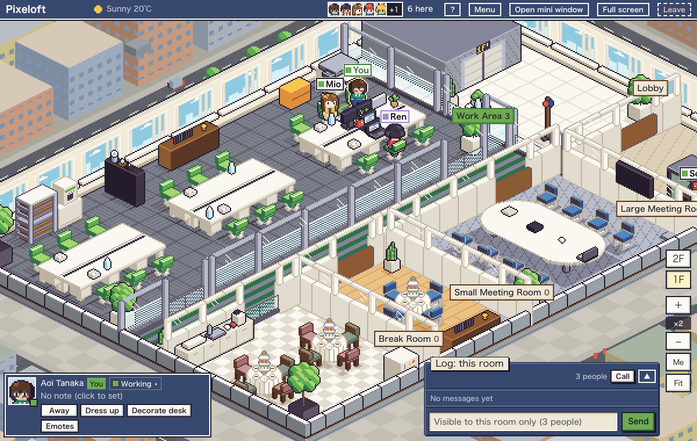

# Pixeloft

[English](README.md)

席に座るタイプの、アイソメ調ドット絵のバーチャルオフィスです。自分も同僚もそれぞれの席に座っていて、誰がいるかが一目で分かります。`docker compose up`1回で、アプリとPostgreSQLが立ち上がります。間取りはGUIのエディタで作れます。




(スクリーンショットは同梱のサンプルマップです。すべて架空の間取りです)

## なぜこの作りか

- **歩き回らず、席に座る。** 席を選んだらそこにいます。キャラクターが歩くのは席を移るときだけです。操作するものがないので、ちらっと見るだけで使えます。
- **WebSocketではなくポーリング。** 画面が見えている間は4秒ごと、隠れている間は60秒ごとのハートビートだけです。リバースプロキシに特別な設定はいりません。
- **監視にならない在席表示。** 見えるのは「どの部屋にいるか」と状態(作業中・集中・休憩・会議中)だけです。席に何時間いるか、最後にいつ操作したかは表示しませんし、今後も入れません。

## 機能

- 在室: 入室・退出・離席、15分で自動の離席中、日付の切り替え、終業後の自動退出
- 状態: 作業中・集中(25分)・休憩・会議中。部屋の種類で自動で付くものもあります
- 部屋ごとのチャット: 今いる部屋だけ、その日だけ、200字、名指し、リアクション、60秒以内の取り消し
- 「ちょっといい？」の声かけと手を振る。Webプッシュで届きます
- 部屋ごとの通話URL(Meet・Zoom・Teamsなど何でも)
- きせかえ: 髪・服・ズボンの色は自由に選べます。髪型・服・小物はドット絵で描いて追加でき、描いたパーツは全員が使えます
- マップエディタ: 真上から見る2D編集とアイソメのプレビュー。アプリの中(`/editor`、管理者のみ)とGitHub Pagesの静的ページの両方にあります
- 時間帯の光、天気(Open-Meteo。任意)、季節の飾り
- メンバー管理: 招待リンク、パスワード再設定リンク。メールや外部のログインサービスは使いません
- 日本語と英語

## クイックスタート

```sh
git clone https://github.com/yhrym/pixeloft.git
cd pixeloft
docker compose up -d
```

<http://localhost:3000/setup>を開きます。

## 初回の/setup

ユーザーが0人のとき、`/setup`で最初の管理者(ログインID・表示名・パスワード)と最初のマップを決めます。

- **サンプルを使う**(既定): 架空の2フロアのオフィスです。言語はブラウザの言語に合わせます
- **JSONを読み込む**: エディタで書き出したマップを使います
- **空で始める**: `/editor`で間取りを作ります

作成後の`/setup`はログイン画面に戻ります。メンバーはメニューの「メンバー」から招待リンクを作って呼びます。

## 設定

環境変数はすべて任意です。

| 変数 | 既定 | 内容 |
|---|---|---|
| `APP_URL` | 空 | 公開URL(例: `https://office.example.com`)。招待・再設定リンクとWebプッシュの連絡先に使います |
| `TZ` | `Asia/Tokyo` | 最初のタイムゾーン(IANA名)。日付の切り替え・自動退出・光がこれに従います |
| `PORT` | `3000` | アプリに対応させるホスト側のポート |
| `TRUSTED_PROXY` | 空 | 自分で管理するリバースプロキシの後ろで動かすときに`1`にします。下の節を参照 |

`docker-compose.yml`と同じ場所の`.env`か、シェルの環境変数で渡します。そのほかは管理画面の設定ページ(`/admin/settings`)で変えられます。タイムゾーン、終業時刻、天気の緯度経度、季節の飾り、部屋ごとの通話URLです。

## リバースプロキシでHTTPSにする

Webプッシュとサービスワーカーは、HTTPS(か`localhost`)でしか動きません。アプリの前にリバースプロキシを置いてください。証明書を自動で取るCaddyの最小の例です。

```
office.example.com {
	reverse_proxy localhost:3000
}
```

そのうえで`.env`に次を書き、`docker compose up -d`をやり直します。

```
APP_URL=https://office.example.com
TRUSTED_PROXY=1
```

`TRUSTED_PROXY`が必要な理由です。ログインの試行制限は、15分で10回まで失敗できる作りです。`TRUSTED_PROXY`がないと、アプリはアクセス元を区別できないので、制限はログインIDだけで数えます。IDを知っている人が間違ったパスワードを打ち続けると、そのアカウントを15分ロックアウトできてしまいます。`TRUSTED_PROXY=1`にすると、`X-Forwarded-For`(プロキシが足した最後の値)からアクセス元を取り、IDとアクセス元の組で数えます。攻撃する人は自分のアドレスだけをロックすることになります。書き込みのOrigin確認も、`X-Forwarded-Host`と`X-Forwarded-Proto`を見るようになります。

すべてのリクエストが本当にプロキシを通るときだけ設定してください。このヘッダーは、ポート3000に届く人なら誰でも付けられます。ポート3000へ直接届かないようにします(ファイアウォール、またはcomposeの上書きで`127.0.0.1`にだけ公開)。

## バックアップとリストア

データはすべてPostgreSQLのボリューム`pgdata`にあります。

```sh
# バックアップ
docker compose exec -T db pg_dump -U vo -Fc vo > pixeloft.dump

# リストア(起動中のDBへ。空でも既存でもよい)
docker compose stop app
docker compose exec -T db pg_restore -U vo -d vo --clean --if-exists < pixeloft.dump
docker compose start app
```

## アップグレード

```sh
git pull
docker compose up -d --build
```

マイグレーションはappコンテナの起動時に自動で流れます。

## appのプロセスは1つだけ

`app`コンテナは1つだけにしてください。1秒キャッシュ・エモーション・ハートビートの間引き・ログインの試行制限はプロセスのメモリに持っているので、2つ動かすと食い違います。1つで会社1つぶんの規模は十分に回ります。

## マップ: PagesとインスタンスでJSONをやりとりする

マップエディタは静的ページとしても公開できるので、何も立てずに間取りを作れます。

`https://yhrym.github.io/pixeloft/editor/`

ドキュメントのサイトは<https://yhrym.github.io/pixeloft/>です。

下書きはブラウザの中だけに保存し、サーバーには何も送りません。**サンプルを開く**で、同梱のサンプルから始められます。

- Pagesからインスタンスへ: Pagesで**JSON書き出し**。インスタンスの`/editor`で**JSON読み込み**し、エラー一覧を直して**公開**します。初回の`/setup`でファイルを選ぶこともできます
- インスタンスからPagesへ: `/editor`で**JSON書き出し**し、Pagesで**JSON読み込み**します

JSONには`version`があります。公開のときにサーバーが検証して、何がだめかを返します。カタログの置き物のidは消さないので、古いマップも動き続けます。

## 開発

```sh
cp .env.example .env
docker compose -f docker-compose.yml -f docker-compose.dev.yml up -d db
npm install
npx prisma migrate deploy
npm run dev
```

`docker-compose.dev.yml`は、DBを`127.0.0.1:${DB_PORT:-5432}`に公開します。5432が使用中なら`DB_PORT=55432`などで起動し、`.env`の`DATABASE_URL`のポートも合わせてください。

```sh
npm test            # ユニットテスト(node:test)
npm run lint
npm run build
npm run build:pages # 静的なマップエディタをdist-pages/に作る
```

外からのプルリクエストは、当面受け付けていません。不具合の報告やアイデアはIssueで歓迎します。詳しくは[CONTRIBUTING.md](CONTRIBUTING.md)。

## ライセンス

AGPL-3.0-only。[LICENSE](LICENSE)を参照してください。Pixeloftを改造してネットワーク越しに使わせる場合は、改造したソースを相手に提供する必要があります。
