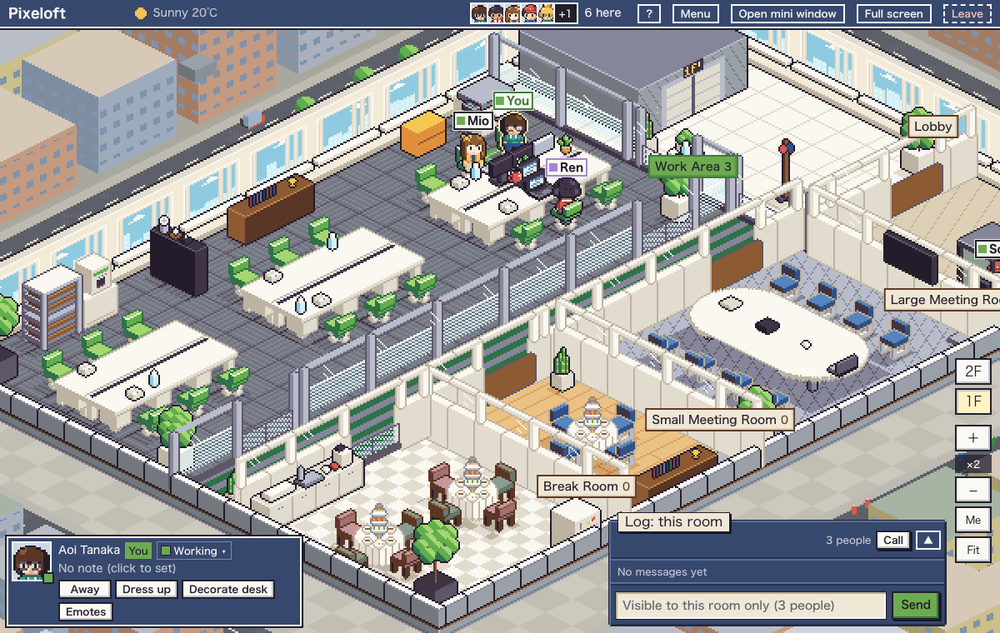

# Pixeloft

[日本語](README.ja.md)

A self-hosted, seat-based virtual office in isometric pixel art. You sit at a desk, your teammates sit at theirs, and you can see at a glance who is around. Run `docker compose up` to start the app and PostgreSQL. You draw the floor plan in a GUI editor.

- [Build your map in the browser](https://yhrym.github.io/pixeloft/editor/): no sign-up. It opens with the sample office, ready to edit.
- [Run it on your own PC](#quick-start): the Docker Compose steps.




(The screenshots show the bundled sample map. The office layout is fictional.)

## Why it is built this way

- **Seats, not walking.** You pick a seat and stay there. There is nothing to steer: when you pick a seat, your character walks there by itself. After 15 minutes without interacting with the office tab, you are marked away.
- **Polling, not WebSocket.** The page polls every 4 seconds while visible and sends a heartbeat every 60 seconds while hidden. Pixeloft uses HTTP polling, so you do not need to configure your reverse proxy for WebSocket connections. For the HTTPS setup, see "HTTPS with a reverse proxy" below.
- **Rooms and statuses.** The office shows who is in which room and their status (working, focus, break, in a meeting). It does not display time spent at a seat or the time of the last interaction with the office tab.

## Features

- Presence: enter, leave, away, auto-away after 15 minutes without interacting with the office tab, daily reset. You leave automatically when the work end hour has passed and you have been idle.
- Statuses: working, focus (25 min), break, in a meeting. Some rooms set a status automatically.
- Chat per room: only the room you are in, only for that day, 200 characters, mentions, reactions, undo within 60 seconds.
- "Got a minute?" calls and waves show up in the office. "Got a minute?" also reaches you as Web Push with the tab closed, once you turn on notifications and allow them in the browser. This needs HTTPS or `localhost`; see "HTTPS with a reverse proxy" below.
- A call URL per room (Meet, Zoom, Teams, anything).
- Wardrobe: any color for hair, clothes and trousers, plus hair styles, clothes and accessories that members draw themselves in a pixel editor. Drawn parts are shared with everyone.
- Map editor: a top-down 2D editor with an isometric preview, in the app (`/editor`, admins only) and as a static page on GitHub Pages.
- Time-of-day lighting, optional weather (Open-Meteo), seasonal decorations.
- Members: invite links, password reset links, no email and no external login service.
- Japanese and English.

## Quick start

You need Git, Docker (with Compose) and a browser.

```sh
git clone https://github.com/yhrym/pixeloft.git
cd pixeloft
docker compose up -d
```

If you started it on your own PC, open <http://localhost:3000/setup>. If you started it on a server, open that server's URL followed by `/setup`.

## First run: /setup

If there are no users yet, `/setup` asks for the first admin (login ID, display name, password) and for the first map:

- **Use the sample** (default): a fictional two-floor office. The language follows your browser.
- **Upload a JSON file**: a map exported from the editor.
- **Start with an empty office**: you build the floor plan in `/editor`.

After that, `/setup` redirects to the login page. Log in as the admin you created and press "Enter", then choose a free seat or press "Seat me anywhere". If you chose "Start with an empty office", open **Editor** in the menu after logging in, place rooms, an entrance and desks, press **Publish**, and then go back to the office and enter. After that, create invite links under **Manage members** in the menu.

## Configuration

Every variable is optional.

| Variable | Default | What it does |
|---|---|---|
| `APP_URL` | empty | Public URL such as `https://office.example.com`. Used for invite and reset links and for the Web Push contact. |
| `TZ` | `Asia/Tokyo` | Initial time zone (IANA name). The date rollover, auto leave and the light follow it. |
| `PORT` | `3000` | Host port that maps to the app. |
| `TRUSTED_PROXY` | empty | Set `1` when the app runs behind a reverse proxy you control. See below. |

Set them in a `.env` file next to `docker-compose.yml` or in the shell. Everything else is in the admin settings page (`/admin/settings`): time zone, closing hour, latitude/longitude for the weather, seasonal decorations, and the call URL per room.

## HTTPS with a reverse proxy

Web Push and the service worker only work on HTTPS (or `localhost`). Put a reverse proxy in front of the app. A minimal Caddy example, which gets a certificate automatically:

```
office.example.com {
	reverse_proxy localhost:3000
}
```

First make sure nobody can reach the app's port directly: publish it only on `127.0.0.1` or restrict it with a firewall. Then set these in `.env` and run `docker compose up -d` again:

```
APP_URL=https://office.example.com
TRUSTED_PROXY=1
```

Why `TRUSTED_PROXY` matters: once 10 failed logins have been counted for the same key within 15 minutes, further logins are refused until that 15-minute window ends. Without `TRUSTED_PROXY` the app cannot tell clients apart, so the limit is counted per login ID only. Anyone who knows an ID can type wrong passwords and block logins to that account until the 15-minute window ends. With `TRUSTED_PROXY=1` the app takes the client address from `X-Forwarded-For` (the last entry, which your proxy adds) and counts failures per ID and address. It also makes the origin check on writes use `X-Forwarded-Host` and `X-Forwarded-Proto`.

Only set it when every request really passes through your proxy. The app trusts those headers from whoever can reach port 3000, so block direct access to that port (firewall, or bind it to `127.0.0.1` with a compose override).

## Backup and restore

Everything is in the PostgreSQL volume `pgdata`.

```sh
# backup
docker compose exec -T db pg_dump -U vo -Fc vo > pixeloft.dump

# restore (into a running, empty or existing database)
docker compose stop app
docker compose exec -T db pg_restore -U vo -d vo --clean --if-exists < pixeloft.dump
docker compose start app
```

## Upgrading

```sh
git pull
docker compose up -d --build
```

Database migrations run automatically when the app container starts.

## Run a single app process

Keep exactly one `app` container. The 1-second state cache, emotes, heartbeat throttling and the login rate limit live in the process memory, so two processes would disagree with each other.

## Maps: moving JSON between Pages and your instance

The map editor is also published as a static page, so you can design a floor plan before you run anything:

`https://yhrym.github.io/pixeloft/editor/`

The docs site is at <https://yhrym.github.io/pixeloft/>.

It opens with the sample map the first time. It stores the draft in your browser only and sends nothing to a server. Use **Open sample** to start over from the bundled sample at any time.

- Pages to your instance: in Pages, **Export JSON**. In your instance, open `/editor`, **Import JSON**, fix any errors in the list, then **Publish**. You can also pick the file on the first `/setup`.
- Your instance to Pages: in `/editor`, **Export JSON**, then **Import JSON** in Pages.

The JSON has a `version` field. Publishing validates the map on the server and tells you what is wrong. Catalog item ids are never removed, so older maps keep working.

## Plugins

Put a folder in `plugins/<id>/` and run `docker compose up --build` to add items and small features, such as a game. Plugins run with the same permissions as the app, so install only ones whose code you have read. How to write one: <https://yhrym.github.io/pixeloft/en/plugins/>

## Development

```sh
cp .env.example .env
docker compose -f docker-compose.yml -f docker-compose.dev.yml up -d db
npm install
npx prisma migrate deploy
npm run dev
```

`docker-compose.dev.yml` publishes the database on `127.0.0.1:${DB_PORT:-5432}`. If 5432 is taken, start with `DB_PORT=55432` and change the port in `DATABASE_URL` in `.env` to match.

```sh
npm test            # unit tests (node:test)
npm run lint
npm run build
npm run build:pages # static map editor into dist-pages/
```

External pull requests are not accepted for now. Bug reports and ideas are welcome as Issues. See [CONTRIBUTING.md](CONTRIBUTING.md).

## License

AGPL-3.0-only, free to use with no paid plan. See [LICENSE](LICENSE). If you modify Pixeloft and let others use it over a network, you must offer them your modified source.
